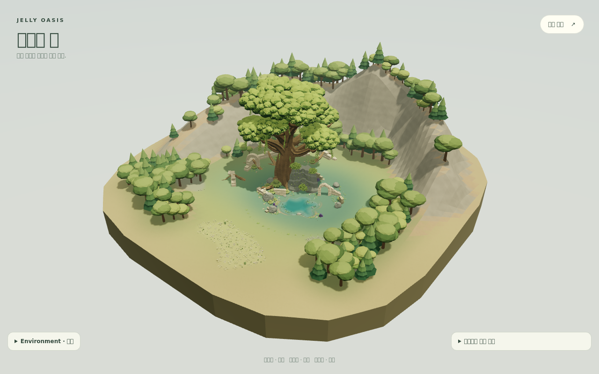
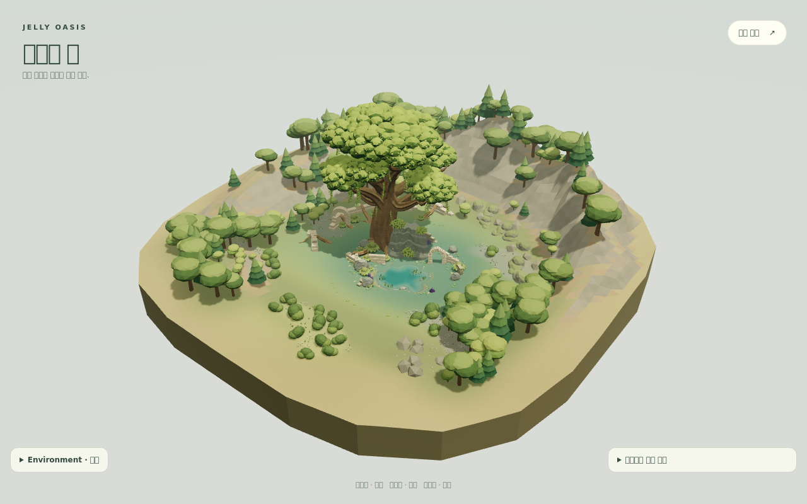

# Jelly Oasis — 숲·암벽·호숫가 연결 개선

기준: `master`의 `01f5d73718c72a93cff71ab859b43820e1fc73d4`.
사용자가 승인한 레퍼런스 적용 방향과 현재 구현 캡처를 기준으로 진행했어요.

## 구도와 구현

| 구역 | 변경 | 의도 |
|---|---|---|
| 뒤쪽 암벽 | 기존 북쪽 언덕과 추가 능선이 겹치던 높이를 줄이고, 능선 사이의 낮은 부분과 식생 선반을 구성했어요. | 큰 회색 벽이 세계수와 경쟁하는 정도를 줄여요. |
| 숲 연결 | 좌·우·뒤쪽에 크기가 작은 나무 군락을 넣고 외곽 나무 할당을 재분배했어요. | 외곽 숲에서 유적 주변까지 여러 높이의 수관이 이어져요. |
| 암벽 하단 | 낮고 불규칙한 세 암체를 합친 로우 폴리 암석을 기존 인스턴싱 시스템에 넣었어요. | 경사면과 숲 바닥 사이에 중간 크기의 형태를 만들어요. |
| 전경 | 중앙 접근 공간 양옆에 완만한 둔덕, 관목 군락, 바위를 배치했어요. | 작은 꽃 점들만 있던 평지에 읽을 수 있는 덩어리와 높낮이가 생겨요. |
| 하층 식생 | 관목은 수관 아래에 들어갈 수 있지만 나무줄기 주변 여유와 길·물·유적의 제외 영역은 유지해요. 관목끼리는 수관이 일부 겹쳐요. | 숲 가장자리가 나무에서 맨땅으로 갑자기 끝나지 않게 해요. |
| 뿌리·유적·물가 | 기존 정원의 관목 덩어리를 연결하고, 수생 식물은 일부 잎이 수면 위로 올라오도록 키웠어요. | 기존 벽·뿌리·호수의 접점을 강화해요. |

Kena의 다층 숲과 열린 중심 공간, TUNIC의 압축된 높낮이, Tiny Glade의 자연과 석조물 접점, The Last Campfire의 작은 식생 군락을 구도 원칙으로 적용했어요. Ori의 과장된 조명은 추가하지 않았어요. 다른 게임 에셋이나 텍스처는 사용하지 않았어요.

세계수 본체의 크기와 형태, 섬 크기 224, 호수 경계·깊이·물 시뮬레이션, 카메라, 낮밤, 날씨 코드는 유지했어요. 흰 발판이나 독립 성소는 추가하지 않았어요. 중앙 반경 60 m와 섬 절단 경계의 높이는 기준 코드와 같아요. 새 식생과 암석은 기존 머티리얼/메시 소유 구조를 사용하며 런타임 의존성도 추가하지 않았어요.

## 실제 화면

같은 카메라·시간·날씨의 전체 보기예요.

변경 전:



변경 후:



[세계수 앞](../artifacts/jelly-oasis/connected-forest-v1/worldtree-front.png) · [뒷면](../artifacts/jelly-oasis/connected-forest-v1/worldtree-rear.png) · [뿌리와 벽](../artifacts/jelly-oasis/connected-forest-v1/worldtree-roots.png) · [호숫가](../artifacts/jelly-oasis/connected-forest-v1/lake-day.png) · [밤](../artifacts/jelly-oasis/connected-forest-v1/medium-night.png) · [비](../artifacts/jelly-oasis/connected-forest-v1/lake-rain.png) · [모바일](../artifacts/jelly-oasis/connected-forest-v1/390-presentation.png)

캡처 환경에는 한글 시스템 폰트가 없어 일부 UI 글자가 네모로 표시돼요. 애플리케이션의 글꼴이나 UI 문구는 변경하지 않았어요.

## 검증

- 전체 테스트: 67개 파일 / 330개 테스트 통과. 마지막 식생·수생식물 조정 후 관련 5개 테스트 재실행 통과, 최종 암석 형태 수정 후 scenery 2개 테스트 재실행 통과.
- 최종 `npm run lint`, `npm run build`, `git diff --check` 통과.
- Chromium 133 / SwiftShader에서 데스크톱 1280×800, 모바일 에뮬레이션 390×844로 실행했어요. 낮·밤·비, 마우스 확대, 터치 핀치, 초기화, 지형 재생성, 수면 GPGPU 경로를 확인했어요. 페이지/콘솔 오류 0건이에요.
- 재생성 후 loop, clearing, approach, passage 검사 모두 통과했어요.
- 실제 GLB를 사용한 배치 테스트에서 지면 접촉, 경사 제한, 보호 영역, 위치·회전·크기 변경, 결정적 배치, dispose 동작을 확인했어요.
- 기준 코드에서도 발생하는 `THREE.Material: parameter 'side' has value of undefined` 경고는 이번 변경 범위 밖이에요.

## 렌더링 비교

같은 QA 스크립트로 기준 master와 변경본을 각각 실행했어요. 수치는 그림자 패스를 포함하며, FPS나 실제 휴대폰 성능 측정은 아니에요.

| 화면 | draw calls 전 → 후 | triangles 전 → 후 |
|---|---:|---:|
| 데스크톱 전체 보기 · 낮 | 90 → 96 | 720,586 → 718,082 |
| 데스크톱 뿌리 근접 · 낮 | 68 → 78 | 682,966 → 717,182 |
| 모바일 기본 화면 · 낮 | 90 → 96 | 555,787 → 565,055 |
| 모바일 기본 화면 · 밤 | 92 → 98 | 555,787 → 565,055 |

모바일 기본 화면의 삼각형 수는 약 1.7% 증가했어요. 낮 화면의 리소스는 양쪽 모두 geometry 94 / texture 10이에요. 근접 화면에서는 보이는 군락과 암석 배치가 달라져 호출 수가 10개 증가해요. 모바일에서는 연결부 나무와 암석을 유지하고 외곽 채움용 나무를 줄여요. 실제 저사양 휴대폰에서의 프레임 시간은 별도 확인이 필요해요.

배치 결과는 데스크톱 일반 나무 240그루, 작은 돌 12개, 바위 18개, 낮은 암석 군락 8개, meadow 관목 20개예요. 세계수 정원과 기존 식생은 별도예요.

원자료: [비교 수치](../artifacts/jelly-oasis/connected-forest-v1/comparison.json), [변경본 브라우저 QA](../artifacts/jelly-oasis/connected-forest-v1/sacred-lake-browser.json), [기준 브라우저 QA](../artifacts/jelly-oasis/connected-forest-v1/before-browser.json).

재현 명령:

```sh
OASIS_QA_BROWSER=/path/to/chromium \
OASIS_QA_OUTPUT=artifacts/jelly-oasis/connected-forest-v1 \
node scripts/worldtree-browser-qa.mjs
```

`OASIS_QA_PORT`로 서버 포트를 바꿀 수 있어요. 실행 환경에 WebGL/SwiftShader가 지원되는 Chromium이 필요해요.
